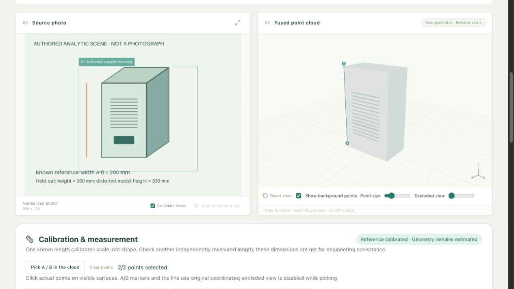
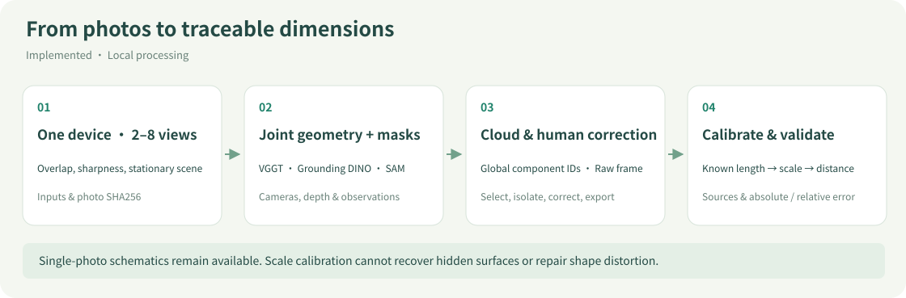
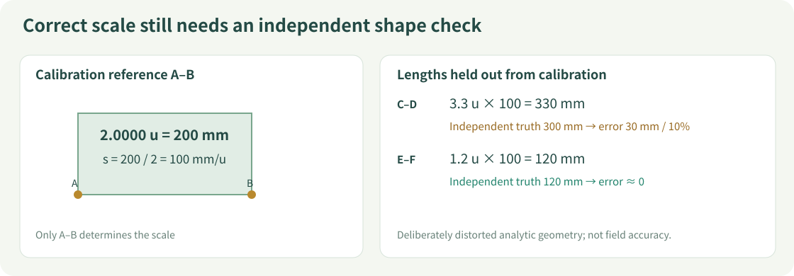
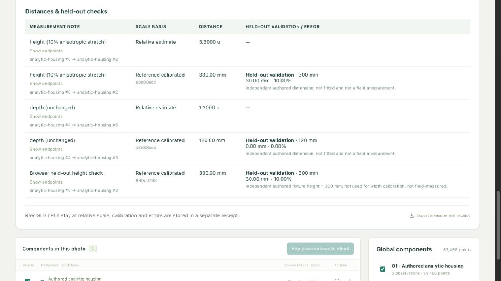
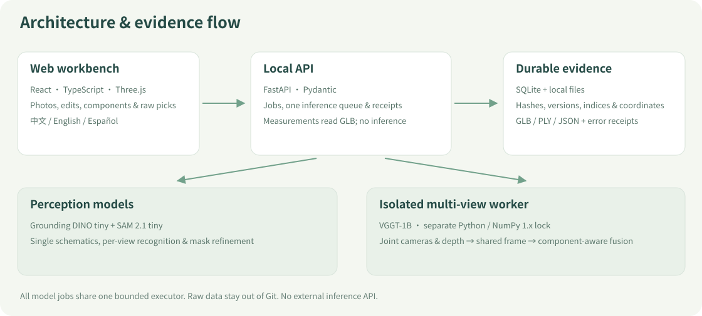

# 2Dto3D · Equipment Structure Workbench

[中文](README.md) · **English** · [Measurement guide (Chinese)](docs/measurement/README.md) · [Evidence & handoff](docs/quality/README.md)

Explore **visible components and relative 3D structure** from photovoltaic equipment photos. Detect, segment, inspect, and correct components; establish scale with one known length, then check another independent length. Photos and inference stay on the local machine.

**Implemented:** single-photo schematics · 2–8-view clouds of one stationary device · component association and correction · known-length calibration · straight-line measurement · held-out length errors · Chinese, English, and Spanish UI.



*An actual browser screenshot using an authored analytic scene generated by this repository. It is not a field photograph or a model-quality sample. It reproduces the picking/calibration/measurement workflow; field dimension accuracy remains unverified.*

## What it does

| Path | Input and output | Meaning of dimensions |
|---|---|---|
| Single-photo schematic | One photo → editable components → simple boxes, rods and cable bundles | Proportions and thickness use priors; ineligible for physical measurement |
| Multi-view colored cloud | 2–8 overlapping views of one stationary device → joint cameras/depth → component cloud | Estimated visible-surface geometry; metric scale initially unknown |
| Calibration and measurement | Pick A/B → enter a known length → measure a different segment | Globally rescaled estimates with a traceable reference and held-out errors |

Phase 1 focuses on **string inverters and external mounting structures**. Boxes, masks, observation IDs, global component IDs and scene nodes are linked. Hide, isolate, use explanatory exploded views, and export GLB / PLY / JSON. Substations, transformers and full equipment ownership trees are on the [roadmap](docs/roadmap.md).



## Start with the model-free demo

Requires Python **3.12**, [uv](https://docs.astral.sh/uv/), and Node.js **22.12+**. Authenticate with a GitHub account that can access this private repository.

```bash
git clone https://github.com/HenryVarro666/2Dto3D.git
cd 2Dto3D
uv sync --frozen --extra dev
npm --prefix apps/web ci
.venv/bin/python scripts/measurement_demo.py --evaluate
PV3D_DATA_DIR="$PWD/data/measurement-demo" make dev
```

Open the [workbench](http://127.0.0.1:5173), choose **Multi-view cloud**, paste the script's **Job ID** into **Restore a point-cloud job**, and click **Open saved result**. Show the reference endpoints or recorded distance endpoints to see A/B and the line in the actual Three.js viewer. API docs: [8000/docs](http://127.0.0.1:8000/docs).

This demo **directly authors analytic GLB geometry and receipts; it does not call detection or reconstruction models**. It verifies software behavior, not VGGT quality. Viewing and measurement work; refinement and component reconstruction are disabled for the authored demo. Use real multi-view output for that workflow. Running it again appends immutable measurement history. Stop services with `Ctrl+C`. Demo data stays in ignored `data/measurement-demo/`; regenerate it on each machine. Generated Job IDs may differ.

## Run models on real photos

```bash
make setup                 # API, frontend and perception dependencies
make models                # Grounding DINO + SAM 2.1
make setup-multiview        # Isolated VGGT environment
make models-multiview       # About 5GB of weights on first download
make dev
```

Skip the two `multiview` commands for single-photo use. Model revisions are pinned and cached under `models/huggingface/`; first downloads and cold process starts take longer. Inference is local and needs no external inference API.

1. Capture 2–8 overlapping photos of one stationary device. Avoid camera rotation without translation, moving objects, and duplicate images. See the [capture guide](docs/v3/capture-guide.md).
2. Click **Fuse and identify components**, then follow actual processing stages and elapsed time.
3. Review each photo's boxes, complete SAM masks and component assignments. Reframe, refine with positive/negative points, associate or split observations. Manual updates reuse the original joint geometry.
4. Pick identifiable points in the cloud and calibrate/validate as below. Recalibrate after geometry changes.

Small real-model examples have run on **M4 Pro / 24GB / MPS**. RTX 5080 execution is unverified; the [hardware guide](docs/hardware.md) separates tested configurations from candidates. Default original **VGGT-1B weights have a non-commercial license**; see [models and licensing](docs/v3/models.md).

## Calibration, measurement and error



- **Uncalibrated:** “Estimated geometry · Scale unknown”; distances use relative `u`, without unsupported mm values.
- **Known-length calibration:** select actual points A/B, enter a length, mm/cm/m and its source. Scale is `s = known_length_mm / ||B−A||`.
- **Two-point measurement:** select another pair and inspect its relative distance and reference-calibrated length. This is a straight line, not a cable's curved path length.
- **Held-out validation:** enter an independently measured length that was not used to fit scale, plus its source. Record absolute and relative error. The service rejects the reference, its reverse, and coordinate-identical duplicate points as checks; humans must still confirm that nearby points do not redraw the same physical segment.

Calibration changes scale, **not shape or hidden surfaces**. Picking disables exploded view. Measurements use original GLB coordinates, unaffected by camera, centering or exploded display offsets. Each receipt binds job ID, point indices and GLB SHA256. New jobs or changed geometry cannot reuse an old calibration.



The demo calibrates a **200 mm** width. Its held-out analytic height is **300 mm**, but the distorted geometry measures **330 mm**: **30 mm / 10%** error. An independent **120 mm** depth measures approximately **120 mm**. This is a deliberately constructed anisotropic-distortion counterexample, **not field accuracy or a millimeter-precision promise**. [Reproduction and limits](docs/quality/2026-10-31-scale-measurement.md).

Raw **GLB / PLY always retain relative scale**; calibration does not silently rescale them. **Export measurement receipt** downloads separate JSON containing reference evidence, original endpoints, scale, length sources and validation errors. SQLite persists receipts across restarts; restore by Job ID. Cloning code does not automatically copy photos or the database. See [continuing on another machine](docs/measurement/README.md#跨机器延续实验).

## Architecture



| Layer | Implementation |
|---|---|
| Workbench | React, TypeScript, Three.js; Chinese / English / Spanish switching preserves tasks, view and user notes |
| Service and persistence | FastAPI, Pydantic, SQLite, immutable local files |
| Detection and masks | Grounding DINO tiny + SAM 2.1 tiny; candidates require review; optional larger SAM presets are unbenchmarked |
| Joint geometry | Pinned VGGT-1B; separate Python / NumPy 1.x environment, isolated from the API's NumPy 2 environment |
| Clouds and association | Shared coordinates, component-aware sampling/voxel fusion, suggested cross-view associations, complete binary masks |
| Scale and measurement | Resolve actual GLB point indices and original coordinates; no model rerun; immutable calibrations and error receipts |

`apps/web/` contains the UI; `services/api/` provides jobs, geometry and measurement; `services/multiview/` isolates VGGT; `scripts/` includes local runners and the reproducible demo. See the [API contract](docs/api-contract.md).

## Verification and limits

```bash
make test
make build
.venv/bin/ruff check .
.venv/bin/python scripts/readme_figures.py --check
```

`make build && make serve` serves both production UI and API at [port 8000](http://127.0.0.1:8000). `uv.lock` and `package-lock.json` pin dependencies. [Running and troubleshooting](docs/running.md) covers environments, timing scope and service settings.

The latest paired E04 run shows partial improvement while retaining new thin-pole misses and semantic errors. Its [local before/after gallery](data/collections/sungrow/evaluation/runs/2026-10-31_v3_multiview_fix_4groups/index.html) is ignored and is not included in a clone.

Real-photo evaluations and analytic measurement tests are separate evidence: [experiments E01–E05](docs/quality/experiments.md), [issue ledger](docs/quality/issues.md), and [verification log](docs/verification.md). Real photos can still produce misclassifications, incorrect associations, thin-wire loss, holes and sheet-like geometry. The ledger is authoritative; a `succeeded` job does not establish domain accuracy.

**Unverified:** field dimension errors against independent physical measurements, complex occlusions, complete backsides, curved lengths, manufacturing CAD and complete engineering BOMs. Detection scores are uncalibrated; exploded positions do not describe a disassembly procedure. Future problems, failed hypotheses, improvements and tests must be appended under the [evidence and handoff rules](docs/quality/README.md).

## Documentation

| Intent | Entry point |
|---|---|
| Install or troubleshoot on another machine | [Running](docs/running.md) · [Hardware](docs/hardware.md) |
| Capture views and correct components | [V3 capture guide](docs/v3/capture-guide.md) · [Models and geometry](docs/v3/models.md) |
| Calibrate, validate and migrate records | [Measurement guide](docs/measurement/README.md) · [This validation](docs/quality/2026-10-31-scale-measurement.md) |
| Understand scope and contracts | [Project plan](docs/plan.md) · [API](docs/api-contract.md) · [Roadmap](docs/roadmap.md) |
| Continue development or inspect past issues | [Contributing](CONTRIBUTING.md) · [Issues and experiments](docs/quality/README.md) · [Changelog](CHANGELOG.md) |
| Maintain README visuals | [Figure provenance and regeneration](docs/assets/README.md) |

Historical [V1](https://github.com/HenryVarro666/2Dto3D/releases/tag/v1.0.0) / [V2](https://github.com/HenryVarro666/2Dto3D/releases/tag/v2.0.0) snapshots remain. The repository is private and has no selected public-release license; models, libraries and data retain their own licenses. Raw photos, weights, SQLite and generated experiment artifacts stay out of Git. These committed screenshots contain only the authored analytic scene and actual UI; diagrams are not measurement evidence.
