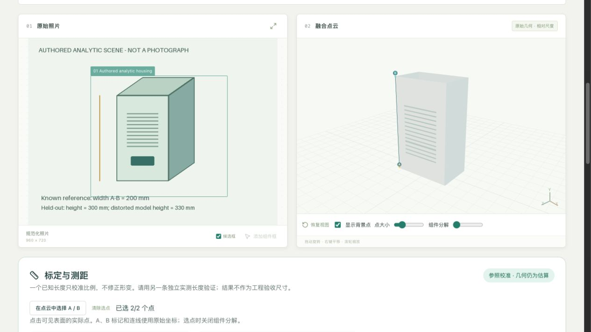
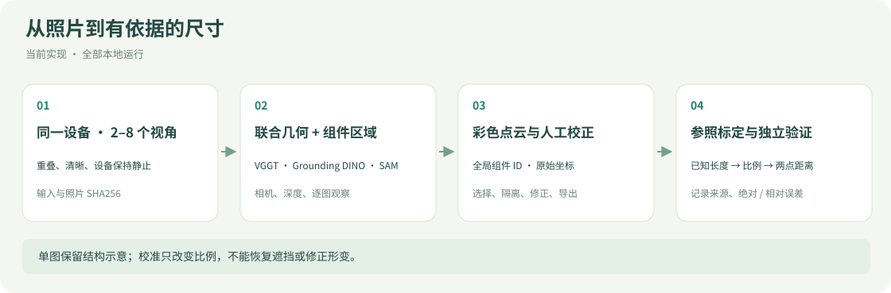
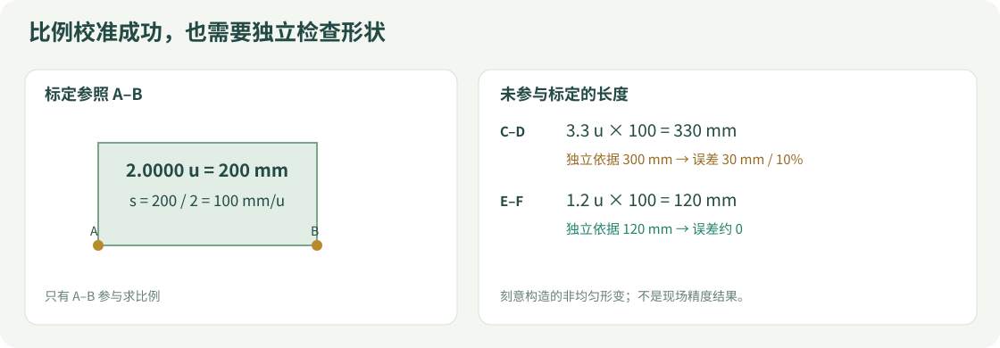
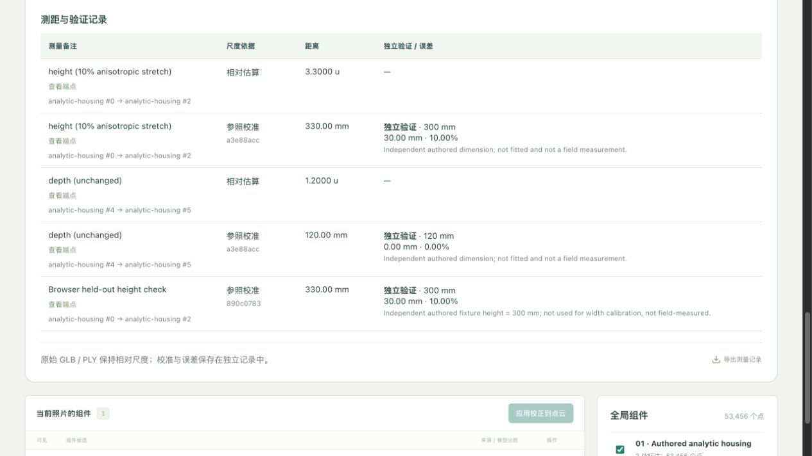
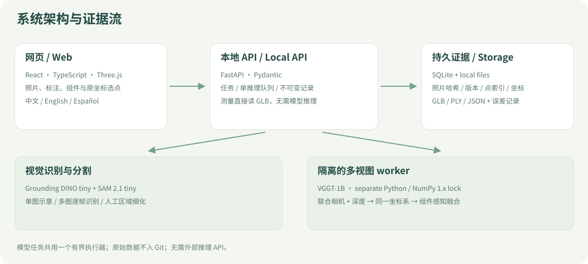

# 2Dto3D · 设备结构工作台

**中文** · [English](README.en.md) · [测量指南](docs/measurement/README.md) · [验证与交接](docs/quality/README.md)

从光伏设备照片探索**可见组件与相对三维结构**：识别、分割、旋转查看、人工校正，再用已知长度建立尺度，用另一条独立长度检查误差。照片与推理均在本机处理。

**已实现：** 单图结构示意 · 同一静止设备 2–8 视角点云 · 组件关联和修正 · 已知长度标定 · 两点直线测距 · 独立长度误差记录 · 中英西三语界面。



*真实网页截图，输入为本仓库生成的原创解析场景，不是现场照片或模型精度样本。用于复现选点、标定与测量链路；真实设备精度仍待独立实测。*

## 它能做什么

| 路径 | 输入与输出 | 尺寸含义 |
|---|---|---|
| 单图结构示意 | 一张照片 → 可编辑组件 → 简化箱体、杆件与线束 | 比例与厚度来自先验，不用于实物测量 |
| 多图彩色点云 | 同一静止设备的 2–8 张重叠照片 → 联合相机、深度 → 组件点云 | 可见表面的模型估算几何；初始尺度未知 |
| 参照标定与测距 | 点云中选择 A/B → 输入已知长度 → 测另一条线 | 全局比例校准后的估算尺寸；保留参照与独立验证误差 |

一期聚焦**组串式逆变器及其外部安装结构**。框、mask、观察 ID、全局组件 ID 与三维节点可以联动；支持隐藏、隔离、解释性的组件分解，以及 GLB / PLY / JSON 导出。箱变、变压器和完整设备归属树见[路线图](docs/roadmap.md)。



## 先运行不下载模型的演示

需要 Python **3.12**、[uv](https://docs.astral.sh/uv/) 和 Node.js **22.12+**。私有仓库需使用有权限的 GitHub 账号克隆。

```bash
git clone https://github.com/HenryVarro666/2Dto3D.git
cd 2Dto3D
uv sync --frozen --extra dev
npm --prefix apps/web ci
.venv/bin/python scripts/measurement_demo.py --evaluate
PV3D_DATA_DIR="$PWD/data/measurement-demo" make dev
```

打开 [工作台](http://127.0.0.1:5173)，切换“多角度点云”，将脚本输出的 **Job ID** 填入“恢复已有点云任务”，点击“打开已有结果”。查看参照端点或历史测距端点，就能在真实 Three.js 视图里看到 A/B 和连线。API 文档在 [8000/docs](http://127.0.0.1:8000/docs)。

这个演示**直接生成解析 GLB 与记录，不调用识别或重建模型**。它验证软件行为，不能代表 VGGT 效果。再次执行会追加不可变测量历史。停止服务使用 `Ctrl+C`。演示数据存于 ignored `data/measurement-demo/`，每台机器可自行生成；不同机器的 Job ID 不保证相同。

## 用真实照片运行模型

```bash
make setup                 # API、前端与识别依赖
make models                # Grounding DINO + SAM 2.1
make setup-multiview        # 隔离的 VGGT 环境
make models-multiview       # 首次下载约 5GB 权重
make dev
```

仅使用单图可跳过两个 `multiview` 命令。权重固定 revision，缓存到 `models/huggingface/`；首次下载和新进程冷启动较慢。模型在本地运行，无需外部推理 API。

1. 拍同一静止设备的 2–8 张照片，保持重叠，避免只原地旋转相机、移动物体和重复照片。详见[拍摄指南](docs/v3/capture-guide.md)。
2. 点击“融合并识别组件”，按真实阶段查看进度与已用时间。
3. 逐图核对候选框、完整 SAM 区域和组件归属；支持重框、正负点细化、关联或拆开观察。人工更新复用原联合几何。
4. 在点云里选择可辨认的端点，按下节标定与验证；换几何版本后重新标定。

已在 **M4 Pro / 24GB / MPS** 上运行少量真实模型样例。RTX 5080 尚未实机验证；[硬件说明](docs/hardware.md)区分可运行配置与待测试候选。默认原始 **VGGT-1B 权重受非商业许可约束**，详见[模型与许可](docs/v3/models.md)。

## 标定、测距与误差



- **未标定**：显示“估算几何 · 尺度未知”，距离使用相对单位 `u`，不展示未经依据的 mm。
- **已知尺寸标定**：选择实际点 A/B，填写长度、mm/cm/m 及来源。比例为 `s = 已知长度(mm) / ||B−A||`。
- **两点测距**：选择另一对点，显示原始相对距离与参照校准尺寸。测的是两点直线距离，不是线缆沿曲线的长度。
- **独立验证**：输入未参与标定的实测长度及来源，记录绝对误差与相对误差。服务端拒绝原标定线、反向线及同坐标复制点作为验证线；相邻端点是否仍代表同一条实物线需要人工核对。

标定只改变比例，**不修正几何形变，也不补出遮挡面**。选点时关闭组件分解；测量基于原 GLB 坐标，不受相机、居中和分解位置影响。每份记录绑定任务、点索引与 GLB SHA256；新任务或变化后的几何不能沿用旧标定。



本演示用宽度 **200 mm** 标定，未参与标定的解析高度 **300 mm** 测得 **330 mm**，误差 **30 mm / 10%**；解析深度 **120 mm** 测得约 **120 mm**。这是刻意构造的非均匀形变反例，**不是现场准确率或毫米级精度承诺**。[完整复现与限制](docs/quality/2026-10-31-scale-measurement.md)。

原始 **GLB / PLY 始终保持相对尺度**，标定不会暗中重缩放它们。“导出测量记录”提供单独 JSON：参照、两点原坐标、比例、长度来源和验证误差均保留。记录存于本地 SQLite，重启后可按 Job ID 恢复。换机器运行代码不等于自动同步照片与数据库，参见[跨机器延续实验](docs/measurement/README.md#跨机器延续实验)。

## 如何实现



| 层次 | 当前实现 |
|---|---|
| 工作台 | React、TypeScript、Three.js；中 / 英 / 西即时切换，保留任务、视角与用户备注 |
| 服务与持久化 | FastAPI、Pydantic、SQLite、不可变本地文件 |
| 检测与分割 | Grounding DINO tiny + SAM 2.1 tiny；候选必须核对，可选更大 SAM 尚未基准测试 |
| 联合几何 | 固定 VGGT-1B；独立 Python / NumPy 1.x 环境，与 API 的 NumPy 2 环境隔离 |
| 点云与关联 | 同一坐标系、组件感知采样 / 体素融合、跨图关联建议、完整二值 mask |
| 尺度与测量 | 从实际 GLB 解析点索引与原始坐标；无需再次运行模型；不可变标定及误差记录 |

代码目录：`apps/web/` 为网页，`services/api/` 为任务、几何和测量，`services/multiview/` 为隔离 VGGT，`scripts/` 提供运行与可复现演示。接口见 [API 契约](docs/api-contract.md)。

## 验证与已知限制

```bash
make test
make build
.venv/bin/ruff check .
.venv/bin/python scripts/readme_figures.py --check
```

`make build && make serve` 会在 [8000 端口](http://127.0.0.1:8000) 同时提供生产网页与 API。依赖由 `uv.lock` 和 `package-lock.json` 固定；[运行与排错](docs/running.md)包含环境、冷暖耗时和服务设置。

最新 E04 同四组修复已有部分改善，同时保留新增细柱漏检和语义误分类；[本机前后图入口](data/collections/sungrow/evaluation/runs/2026-10-31_v3_multiview_fix_4groups/index.html)为 ignored 产物，不随克隆。

真实照片评估与解析测量测试分别记录，不能互相代替：[实验索引 E01–E05](docs/quality/experiments.md)、[问题台账](docs/quality/issues.md)、[验证记录](docs/verification.md)。目前真实照片仍可能出现误分类、组件关联错误、细线丢点、空洞和薄片；详细状态以台账为准，任务 `succeeded` 不等于领域准确率。

**仍待验证：** 独立实测的现场尺寸误差、复杂遮挡结构、完整背面、曲面长度、制造 CAD 与完整工程 BOM。自动分数未校准；解释性分解位置不是拆装步骤。后续每次问题、失败试验、改进和测试都需按[质量交接规则](docs/quality/README.md)追加保存。

## 文档导航

| 我要做什么 | 入口 |
|---|---|
| 新机器安装、排错 | [运行说明](docs/running.md) · [硬件](docs/hardware.md) |
| 拍多视角照片、修正组件 | [V3 操作指南](docs/v3/capture-guide.md) · [模型与几何](docs/v3/models.md) |
| 标定、独立验证、迁移记录 | [测量指南](docs/measurement/README.md) · [本次验证](docs/quality/2026-10-31-scale-measurement.md) |
| 了解计划、契约与后续范围 | [项目计划](docs/plan.md) · [API](docs/api-contract.md) · [路线图](docs/roadmap.md) |
| 接手开发或复核历史问题 | [贡献约定](CONTRIBUTING.md) · [问题与实验](docs/quality/README.md) · [版本变化](CHANGELOG.md) |
| 更新 README 的图 | [配图来源与重建方式](docs/assets/README.md) |

[历史 V1](https://github.com/HenryVarro666/2Dto3D/releases/tag/v1.0.0) / [V2](https://github.com/HenryVarro666/2Dto3D/releases/tag/v2.0.0) 快照保留。仓库默认私有，本阶段未选择开源发布许可；模型、库及数据各有自己的许可。原始照片、权重、SQLite 与实验生成产物默认不进入 Git；这里的截图只包含原创解析场景和真实 UI，图示不充当实测证据。
