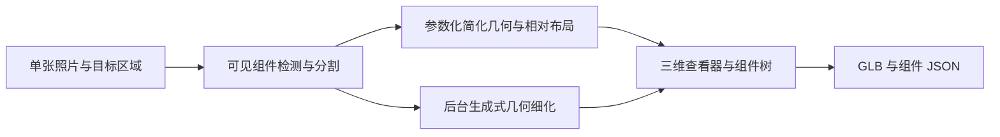

# 2Dto3D

从户外光伏设备照片生成可交互的三维结构示意，帮助辨认可见组件及其相对位置。

**当前状态：方案与技术调研阶段。应用代码、模型推理及性能评测尚未实现。**

## 已确定的第一版目标

- 单张照片优先，信息不足时提示补拍。
- 提交后 **10 秒内出现可旋转的初步三维结构示意**，这是待实测的验收目标。
- 可以先用箱体、杆件、底座等简化几何表达组成，再后台细化外形和纹理。
- 支持点选组件、隐藏与隔离，提供用于观察组成的爆炸图。

首个候选场景是立柱安装的组串式逆变器及其外部安装结构。组件清单仅描述有照片依据的可见组成；未观测的背面和内部保留为未知或推测。示意模型采用估计比例，不能直接用于尺寸测量。

## 实现路线



快速路径负责结构示意；后台路径尝试恢复更接近照片的外形。后台能逐组件细化时保留相同组件 ID，并记录几何来源；若只能生成整物网格，则单独标为“未分解细化”，继续保留原有示意组件，不能宣称完成了逐组件替换。只有照片对应的组件与三维对象能够一致关联时，组件化展示才算通过。

## 文档

- [项目计划书](docs/plan.md)：范围、技术栈、数据契约、10 秒目标和分阶段验收。
- [技术调研索引](docs/research/README.md)：模型、组件理解和几何方法的官方资料。
- [数据说明](data/README.md)：本地照片、标注、数据切分及来源记录。
- [开发约定](CONTRIBUTING.md)：后续实现和实验记录方式。

## 建议技术栈

| 层次 | 建议 |
| --- | --- |
| 查看器 | React、TypeScript、Three.js |
| 服务与数据契约 | Python、FastAPI、Pydantic |
| 快速结构分析 | OpenCV、GroundingDINO + SAM 2，支持人工框选与纠正 |
| 结构示意 | 参数化箱体、柱体及板件，组件共用相对坐标系 |
| 后台几何候选 | SAM 3D Objects、TRELLIS.2，先小样本比较 |
| 网格与导出 | Trimesh、GLB + JSON |
| 持久化 | SQLite、本地文件、单个持久任务 worker |

这些是选型建议，尚未锁定运行版本。大型模型优先验证 Linux + NVIDIA GPU 环境；浏览器和 API 可以独立部署。Blender 用于查看导出的网格及后续人工编辑。

## 仓库与本地数据

```text
2Dto3D/
├── README.md
├── AGENTS.md
├── CONTRIBUTING.md
├── docs/
│   ├── plan.md
│   └── research/
├── data/                   # 说明文件入库，实际数据默认忽略
└── photos/                 # 用户原始照片，仅保留在本地
```

代码目录将按计划书在实现阶段建立。目前没有安装或启动命令。照片、模型权重和生成资产默认不进入 Git 历史。候选模型及数据的许可独立于本仓库；本阶段未选择开源发布许可。
