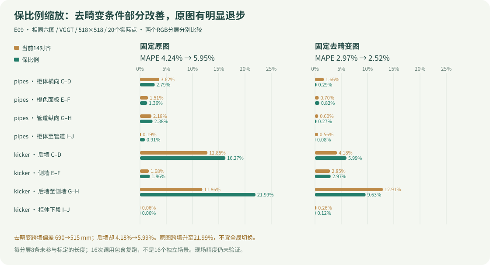
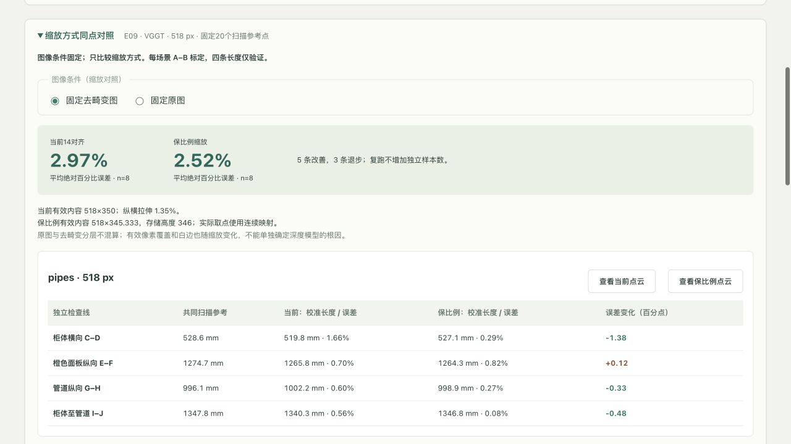
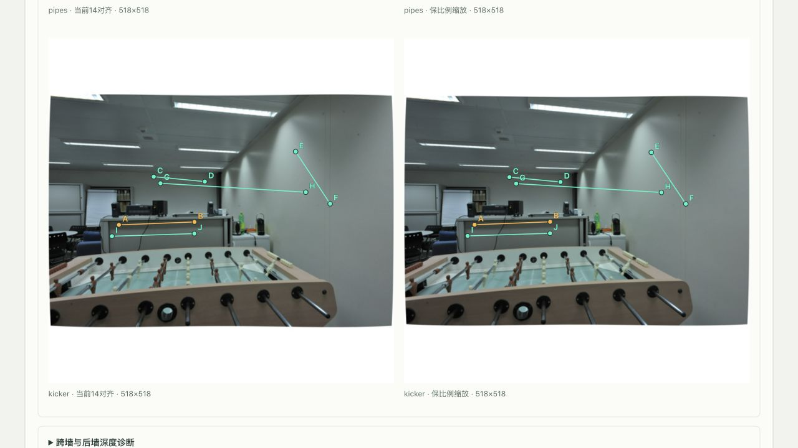
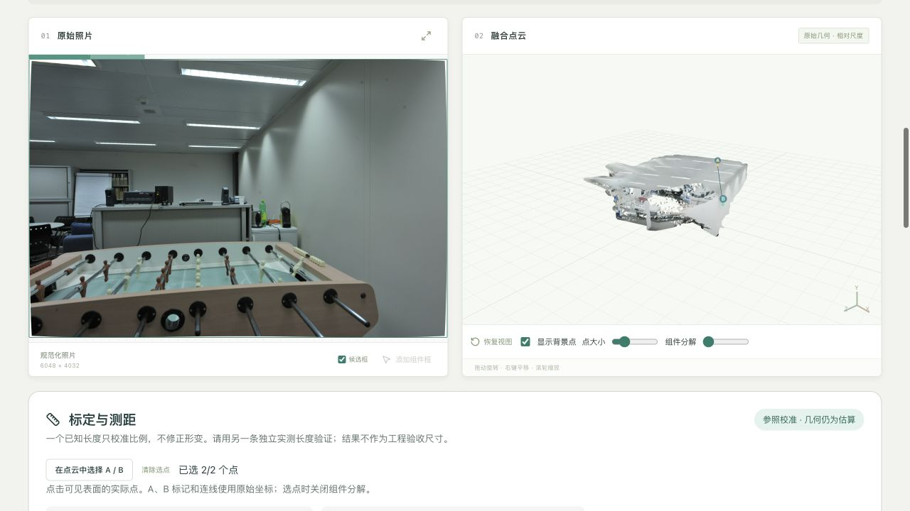

# E09：当前缩放与保比例缩放，固定实际位置的518对照

状态：16次真实VGGT主轮/逆序复跑完成，保比例效果依赖RGB条件，部分改善并有明显退步；网页/审查/交付验证继续追加。

用户已明确授权本轮受控执行、网页/中英文README/私有仓库同步。沿用[E08](2026-11-01-undistortion-fixed-points.md)的六张照片和20个实际扫描点，不因新输出像素移动端点。当前`SCALE-010`已观察到14对齐将6048×4032压为518×350，纵横比例相对拉伸1.35%；它是待验证的预处理假设，不是已证实的几何根因。

[完整设计与执行计划](../superpowers/plans/2026-11-01-aspect-ratio-fixed-points.md)。本轮在原图/去畸变RGB两个分层内分别比较缩放，主要观察去畸变kicker跨墙；同VGGT、同518方形输入、同物理位置、各自只用A–B拟合比例。16次真实调用计划包含主轮与逆序复跑，不增加独立场景数。

保比例方案采用相同PIL bicubic下采样滤波与单一scale，连续有效内容518×345.333像素，整数存储区域518×346；独立保存分数像素映射，不能将整数高度346或345当作精确保比例。GT深度和长度不用于图像准备或推理。比较包含有效像素覆盖、插值位置和白边变化，不能单独归因于深度头。

所有原始数组、模型输入、点云、日志和数据库保存在ignored `data/measurement-resize/`与既有重放runtime；旧E08协议/结果不改写。后续按实际运行追加改善、退步、失败与验证证据。

独立builder检查已完成，无重要未决问题；用纯Pillow解析fixture确认逆仿射位置相等、浮点box无裁剪/API拒绝，未运行模型。存储边界逐边floor/ceil，短轴白色源padding覆盖bicubic足迹。依据：[Pillow官方resize浮点box文档](https://pillow.readthedocs.io/en/stable/reference/Image.html#PIL.Image.Image.resize)；实际使用项目锁定Pillow12.3.0，不升级依赖。


## 推理前冻结

协议[resize-selection.json](../measurement/resize-selection.json)，SHA256 `174a1e82af46253da4432b29ca22b142bda8382e2d79a5a0e5a4ed3bb217a964`。8个条件已冻结输入RGB文件、实际准备张量、支持区mask、连续/整数映射和20个原实际点；数学逆映射最大残差5.08e-13原图像素，不是物理精度。所有legacy14张量与mask哈希与E08完全相同，取点网格坐标也相同。

几何功能先9项RED（缺新模式/接口）后22项几何/既有回归GREEN；另2项runner测试确认失败病例全部保留且非零退出、张量改变在推理前拒绝。当前全开发后端142 passed/2可选ML skip，Ruff通过。日志在ignored `data/measurement-resize/`；初始lint捕获脚本执行位、导入顺序和循环回调未绑定，已纠正，不影响尚未运行的模型。冻结前未运行本轮模型。


## 真实执行与可比性

协议在`959655a`先提交，再启动模型。VGGT-1B权重revision `860abec7937da0a4c03c41d3c269c366e82abdf9`，代码 `a288dd0f14786c93483e45524328726ab7b1b4ce`，checkpoint SHA256 `f164acf60724910d8fe1578bb499d800850c7bb0948db7555c413f9fbe60467e`，同一M4 Pro/24GB/MPS。没有训练、换模型或把GT交给模型。16次=2场景×原图/去畸变×当前/保比例×主轮/逆序复跑；每分层只有8条未参与标定的长度，两场景不能包装为16个独立场景。

本轮只改预处理方式，模型网格始终518×518。legacy14的有效内容518×350，sx=518/6048、sy=350/4032；相对拉伸1.35135%。isotropic数学定义使用单一s=518/6048，有效内容518×345.333333、纵向偏移86.333333，完整存储区y[86,432)高346。不是先取整到345/346再强称保比例；通过带白色源padding的PIL浮点box，让整数输出窗口按统一比例采样。滤波仍是BICUBIC、reducing_gap=None，长轴处理保留；短轴源box纵向为[-3.89189,4035.89189]，白色guard覆盖完整采样足迹。

数学连续映射、Pillow插值和8bit像素量化是不同层。5.08e-13的逆映射残差只证明坐标公式，并不证明Pillow数值误差、GT不确定度或物理精度。有效内容面积、白边和插值位置随策略一起变化；本轮检验这一整套缩放策略，不能唯一归因于“去掉1.35%拉伸”或某个深度头。

20个物理XYZ/参考长度直接沿用E08，同一RGB条件下实际照片像素不变，只有模型网格位置随准确映射变化；不取最近新像素、不重选GT。支持mask使用真实scale的保守bicubic源足迹腐蚀，再逆映射及四邻域检查；所有20点通过，未按误差排除。每场景只用A–B定比例，其他四条长度不参与。派生端点保存在measurement-anchors层并附四邻域/Z/K/外参依据；完整模型数组、有效支持内原始样本云另存。原始GLB/PLY仍为相对尺度。

**基线核对：** 4个legacy14条件在两轮中均与E08的模型全部数组、输入张量、mask、原始样本/审计GLB哈希和测量值完全一致。新mode的孤立worker实际张量哈希逐case与冻结值相等，输出colors也与无损518预览逐像素相等，避免主进程只“声明”保比例而worker实际没执行。

[主轮完整数值](../measurement/resize-results.json)、[逆序复跑](../measurement/resize-repeat.json)保存主轮/复跑源summary SHA、模型/代码/输入来源和全部记录，原JSON未覆盖。

## 全部前后对照

| 固定RGB条件 | 当前MAPE | 保比例MAPE | 改善/退步 | 当前最大误差 | 保比例最大误差 |
|---|---:|---:|---:|---:|---:|
| original | 4.24398% | 5.95345% | 3 / 5 | 12.84548% | 21.99234% |
| rectified | 2.96569% | 2.52099% | 5 / 3 | 12.90937% | 9.63075% |



### 固定 original RGB

| 场景 / 线段 | 共同扫描参考(mm) | 当前校准长度(mm) | 当前误差 | 保比例校准长度(mm) | 保比例误差 | Δ误差百分点 |
|---|---:|---:|---:|---:|---:|---:|
| pipes / Cabinet horizontal C-D | 528.6418 | 509.49 | 3.623% | 513.87 | 2.794% | -0.829 |
| pipes / Orange panel vertical E-F | 1274.7376 | 1255.47 | 1.512% | 1257.37 | 1.362% | -0.149 |
| pipes / Pipe vertical G-H | 996.1473 | 1017.85 | 2.178% | 1019.86 | 2.380% | +0.202 |
| pipes / Cabinet to pipe I-J | 1347.8165 | 1350.31 | 0.185% | 1360.11 | 0.912% | +0.727 |
| kicker / Back wall C-D | 1719.8135 | 1940.73 | 12.845% | 1999.55 | 16.265% | +3.420 |
| kicker / Side wall E-F | 772.8616 | 759.85 | 1.684% | 758.45 | 1.865% | +0.181 |
| kicker / Back wall to side wall G-H | 5347.8434 | 4713.39 | 11.864% | 4171.73 | 21.992% | +10.129 |
| kicker / Cabinet lower span I-J | 985.1184 | 984.52 | 0.061% | 984.55 | 0.057% | -0.004 |

### 固定 rectified RGB

| 场景 / 线段 | 共同扫描参考(mm) | 当前校准长度(mm) | 当前误差 | 保比例校准长度(mm) | 保比例误差 | Δ误差百分点 |
|---|---:|---:|---:|---:|---:|---:|
| pipes / Cabinet horizontal C-D | 528.6418 | 519.84 | 1.665% | 527.12 | 0.288% | -1.376 |
| pipes / Orange panel vertical E-F | 1274.7376 | 1265.80 | 0.701% | 1264.30 | 0.819% | +0.118 |
| pipes / Pipe vertical G-H | 996.1473 | 1002.15 | 0.603% | 998.87 | 0.273% | -0.330 |
| pipes / Cabinet to pipe I-J | 1347.8165 | 1340.30 | 0.558% | 1346.79 | 0.076% | -0.482 |
| kicker / Back wall C-D | 1719.8135 | 1791.65 | 4.177% | 1616.77 | 5.991% | +1.814 |
| kicker / Side wall E-F | 772.8616 | 750.83 | 2.850% | 749.89 | 2.973% | +0.122 |
| kicker / Back wall to side wall G-H | 5347.8434 | 4657.47 | 12.909% | 4832.81 | 9.631% | -3.279 |
| kicker / Cabinet lower span I-J | 985.1184 | 987.70 | 0.262% | 986.27 | 0.117% | -0.145 |

## kicker跨墙、后墙与先前退步项

**主要分层rectified：** 跨后墙至侧墙G–H真值5347.8434mm，当前4657.4703mm，保比例4832.8062mm；绝对误差690.3731→515.0372mm，12.90937%→9.63075%。这项部分改善，不是恢复准确尺寸。G/H真实相机Z6327.1/1920.8mm，当前校准后5603.3/1833.1，保比例5781.7/1843.8mm；远近跨度由约3770.2增至3937.9mm，但真实约4406.3mm，仍压缩。比例2722.5684→2767.9919mm/u也改变，因此需要同时看相对几何/独立检查，不能把全部改善当成某一个深度点的修复。

**后墙C–D新增退步：** 误差4.177%→5.991%。真实C→D的Z差+342.7mm，当前−749.6mm，保比例约−232.9mm，深度顺序仍相反。Z顺序“更接近”并不保证两点欧氏长度更准确，不能只挑一个诊断数宣布墙面形状已恢复。

**原图保护分层出现明显退步：** kicker跨墙11.864%→21.992%，634.4521→1176.1157mm；远点G的校准Z从5729.5降到5196.3mm，近点H几乎不变（1907.0→1906.7mm）。后墙12.845%→16.265%，侧墙1.684%→1.865%。这表明“去畸变”和缩放策略存在响应差异，不能全局开启保比例并声称所有照片都改善。

E08曾退步的四项，在rectified分层本次表现：pipes柜体至管道0.558%→0.076%改善；kicker跨墙12.909%→9.631%改善；kicker下柜0.262%→0.117%改善；kicker侧墙2.850%→2.973%继续退步。此外pipes橙色面板0.701%→0.819%新增退步。所有数值保留，不按原误差大小删线。

**已知K辅助（不算入主结果）：** rectified保留相同预测Z，仅用已知pinhole K反投影，并各自仅A–B另拟合辅助比例。kicker跨墙12.64563%→9.29743%（完整数值见JSON），仍明显偏差；后墙4.371%→5.888%。因此替换K射线并未消除形变，不能唯一判定深度头、相机估计或训练分布是根因。原图不是pinhole，不做这个辅助检验。

**结论与下一步：** 保留当前legacy14产品默认，不把小样本上条件性的改善升级为全局默认。下一轮应冻结这四组主结果，在未参与开发的新场景/新独立实测长度上验证；如要进一步定位，再单独测试像素平移/边框/有效区域覆盖，或已知相机约束的多视图几何优化，不能同时换所有变量后只报均值。现场PV设备/毫米级精度、隐藏背面和5080仍未验证。

## 复跑与耗时

16次全部succeeded；8个条件的主轮/逆序复跑模型数组、实际张量、原始样本云、审计GLB及全部校准长度完全一致，最大长度变化0mm。160个派生端点和144份标定/相对/校准收据可追溯；重复运行不扩大独立样本。

| 场景 | RGB | 缩放 | 主轮worker(s) | 复跑worker(s) |
|---|---|---|---:|---:|
| pipes | original | legacy14 | 15.97 | 13.21 |
| pipes | original | isotropic | 13.57 | 12.89 |
| pipes | rectified | legacy14 | 18.17 | 13.32 |
| pipes | rectified | isotropic | 14.92 | 13.86 |
| kicker | original | legacy14 | 13.23 | 12.99 |
| kicker | original | isotropic | 14.12 | 13.75 |
| kicker | rectified | legacy14 | 13.81 | 13.93 |
| kicker | rectified | isotropic | 14.61 | 16.33 |

所有权重已磁盘缓存，每次为新worker进程；表中墙钟含进程/模型加载、图像准备、推理、输出与退出，不含首次下载、上传、API测距及浏览器查看，不能称端到端速度。每格仅两次且启动/系统抖动明显，不据此声称保比例更快或更慢。准备阶段8条件的PIL用时单列于`prepare-freeze.log`，不是模型耗时。

## 已知问题、失败与实现改进

- **SCALE-010**：已把“14对齐拉伸”从假设推进为同输入受控测试；rectified平均/跨墙部分改善，original明显退步，未改全局默认，未证明唯一根因。
- **SCALE-011**：仅把短边取整数345/346并不能严格保比例；实现连续单一scale/分数box，与floor/ceil整数存储分开，修复实际取点可能被整数映射改变的问题。9项功能先RED后GREEN、PIL解析ramp与K半像素测试，以及独立worker实际张量哈希验证。
- **SCALE-012**：缩放与RGB预处理响应不同，后墙/侧墙深度与欧氏长度残差仍存在。全部退步作为开放问题保留，known-K辅助未解决跨墙形变。
- **UI-009**：初次新词典误写为zh/en/es对象，而现有约定是[en,es]数组，中文渲染后切英文报undefined.replace。已有切换测试先失败，修正数据结构后通过；保留`ui-dictionary-contract-failed.log`，没有用宽松回退隐藏错误。
- 初次Prettier命令路径从仓库根解释，找不到src文件；改为明确apps/web/src路径。初始Ruff捕获脚本执行位/导入和回调绑定问题；均保存日志并纠正。技能任务标题原写Task1，解析器要求Task 1，计划已改正；不影响实验结果或输入。

## 复现与本机证据

```bash
uv sync --frozen --extra dev
npm --prefix apps/web ci
make setup-multiview
make models-multiview
.venv/bin/python scripts/resize_benchmark.py --download --prepare
.venv/bin/python scripts/resize_benchmark.py --run --run-name my-resize-primary
.venv/bin/python scripts/resize_benchmark.py --run --reverse-order --run-name my-resize-repeat
npm --prefix apps/web run build
PV3D_DATA_DIR="$PWD/data/measurement-public/runtime" make serve
```

首次准备会在新的本机目录生成并验证E08无损RGB；已存在的E08图、协议、结果不改写。--prepare验证冻结E09协议，--freeze-selection只在最初作者建档时使用，不能覆盖。新运行名不能与旧run重复。`--image-conditions`/`--resize-modes`仅用于明确的smoke子集，不能将其包装为完整8条件。`scripts/publish_resize.py`针对本次固定主轮/复跑名发布历史摘要，新run的jobID需手动输入恢复框，不会自动等于归档按钮ID。

ignored `data/measurement-resize/`保存准备518无损预览/mask、主轮/复跑geometry.npz/json、真实worker日志、input manifest、derived-anchor-audit、diagnostics、receipt和全部失败/通过日志。实际RGB输入复用`data/measurement-undistortion/inputs/`，原始下载仍在`data/measurement-public/`；不是把新JPEG预览作为模型输入。重放/预览asset追加到原测量runtime，无关任务不启动/中断。Git仅保存协议、摘要、代码、测试、图表和有来源截图，原始数据/DB/权重仍不随克隆。

Pillow、NumPy主环境与独立worker使用各自锁文件，不升级；模型许可CC-BY-NC4.0，ETH3D照片及衍生截图CC BY-NC-SA4.0，来源与变更见[素材记录](../assets/README.md)。场景/相机/真实深度来源见E07/E08，不将教程建议或模型尺寸当作真值。


## 网页与构建验证

生产8004实际核对：固定去畸变2.97/2.52与5改善3退步，切原图4.24/5.95和21.99%；不会把两分层混算。中/英/西切换保留当前分层、误差与40个输入叠加标记的位置；4张实际预览均518宽且载入成功。英/西已知K辅助12.65/9.30及C/D/G/H深度说明正确翻译，原始来源备注保留。无本机照片的回退由前端测试覆盖。

实际重放当前kicker/rectified任务327b5fd3063945c88bcb658eb95222f4与保比例任务6558249e023c47d3afa05a1c97d9fe1a：各1参照/8条测距、云实际加载、无错误提示；两条件G–H均为measurement-anchors #6/#7，对应4657.47/4832.81mm，独立误差690.37/515.04mm。通用查看器把该检查线显示为A/B，不是参照标定的A–B。

中英文新SVG已由原生浏览器实际检查排版，等横轴显示全部退步；12图确定性检查通过。真实截图无修图：







截图SHA256：

- `resize.zh.jpg`：`92e6e5203523e1ee4a990432f684a8eb5e67921bcb0ce7154cde91a5ba8ba7e0`
- `resize.en.jpg`：`712b8fe6bb3b9c8e0281fa5c0098b0b0d20fa037987ed5da962c01f5e20d49b9`
- `resize-original.zh.jpg`：`02e4efc50c1af20e8120f177421e142de1baa14797e974721c61fca403d7261c`
- `resize-inputs.zh.jpg`：`46c08f4d24e34caaaa7af4cc2ae458ef4de54229c3a3e5baabb020bf3636e1fa`
- `resize-cloud.zh.jpg`：`23b08a67e832090ff2b47c0941160d9e1789dfa45407412ac52a7dccb68ad0f3`

所有截图为正常1280×720原生JPEG。生产页面72前端/144正式ML后端、build/Ruff通过；开发142后端/2可选ML skip。浏览器连接复用了ENV-001已记录的会话重建方式恢复，没有重启模型/生产服务来修改结果。


## 独立审查、新克隆复现与主分支整合

独立整分支审查`cf98129..451eb7e`结论PASS，无实质待修项。审查员实际复测24后端/2缩放UI测试，独立核对8个准备张量/源图/mask/预览、全部主轮/复跑数组及legacy对E08一致性、160端点、32原始/审计云SHA、144收据与MAPE。未由审查员独立运行模型或浏览器，不将其审查范围扩大。

从GitHub私有实验分支**新克隆**451eb7e，重新安装API及隔离VGGT环境，重新从已有公开源数据生成E08原图/去畸变无损RGB，再准备E09各模式，两个冻结协议与所有张量哈希均一致。显式复用已下载ETH3D源数据和checkpoint缓存；没有复用原DB/虚拟环境，也不是首次网络下载或另一台硬件。

新克隆另外两次真实rectified/isotropic/518：pipes29.59s、kicker14.83s；模型全部数组、张量、原始样本GLB、审计GLB与全部校准长度和主轮完全一致，最大变化0mm。它们是交付smoke，不增加8条未参与标定长度的样本数。原始数组/云/收据/DB/日志已复制到ignored `data/measurement-resize/clone-verification-2026-11-01/`，不只留临时路径；runtime副本仅审计，不保证原绝对路径自动迁移。主实验16次，加交付2次，共18次真实调用，统计表只包含主实验。

[机器可读克隆凭证](../measurement/resize-clone-verification.json)保存源码提交、锁/日志SHA及逐case结果。主分支期间新增3个CI修复提交74780be/7172cb9/dc5c990，已在56ee118合入：四个既有前端测试预载入真实viewer、一条长流程预算改15秒及CI文档；没有生产算法变更。唯一issues.md追加冲突保留CI-001与E09两段，未覆盖他人记录。新克隆随后快进56ee118，142后端/2可选ML skip、72前端、build/Ruff/12SVG全通过。

首个feature提交451eb7e在GitHub Actions出现既有viewer等待故障：App.i18n和MultiviewWorkbench两条toBeEnabled等待失败，72项中70通过；本轮两条ResizeComparison测试通过。失败完整日志保留`ci-451eb7e-failed.log`，对应[run41283139285](https://github.com/HenryVarro666/2Dto3D/actions/runs/41283139285)。不通过删断言/假就绪处理；合入已在主分支修复的CI-001补丁后等待新运行，旧失败保留。


云端最终验证：[56ee118 / run41283299273](https://github.com/HenryVarro666/2Dto3D/actions/runs/41283299273)现已completed/success，后端、lint、全部前端与build步骤通过。成功完整日志`ci-56ee118-success.log`、机器结果`ci-56ee118-result.json`与首轮失败同时保留；云端不包含ML模型调用，不能用CI成功替代本机18次真实推理或现场精度验证。审查后只有上游CI测试/文档整合，生产几何/缩放/网页代码与451eb7e完全相同。

交接选择：原图/去畸变分别测试而非混合；采用连续单一scale而非整数短边近似；因原图明显退步保留默认；保留远端已有CI修复及其失败史；本机8004仍依赖本工作树，故保留该ignored工作树供用户继续实验，未删除原数据或切换其他会话的checkout。下一轮先冻结本轮四组结果再补独立新场景，不把调过的8条长度重新称为盲测。
