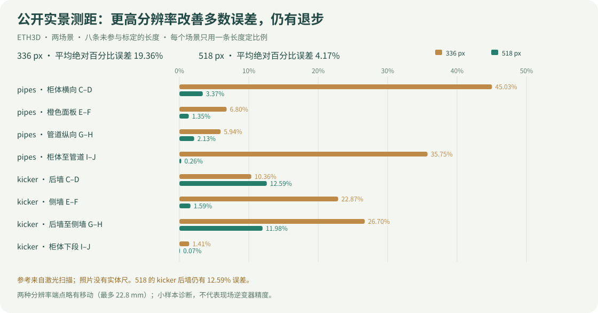

# E07：公开照片的尺度标定与独立测距验证

状态：模型与 API 验证已完成，网页交付检查进行中。准备阶段尚无真实误差结果的历史状态由后续实跑结果更新；下列来源筛选历史保留。

本轮继续主线 `517d04c` 的 E05 标定/测距工具，独立于另一个会话的 E06 组件识别回归。用户没有现场实测长度，授权寻找公开多角度与尺度依据；不将解析 fixture 当作实测。

## 评测协议与研究选择

- [执行计划](../superpowers/plans/2026-11-01-public-metric-measurement.md)。候选为 [ETH3D high-res multi-view training](https://eth3d.ethz.ch/datasets) 的 pipes 与 kicker：真实同场景照片，另附激光扫描渲染参考深度。不是照片中可见的实体尺，也不是逆变器现场验证。
- [官方格式说明](https://eth3d.ethz.ch/documentation)：`*_depth.7z` 是原始畸变照片对应的 float32 深度，并非同名 JPEG 图片；无效值为 infinity。COLMAP `points3D.txt` 是图像三角化结果，**不能当成激光真值**。
- 原图、参考深度及相机文件在模型外单独读取；THIN_PRISM_FISHEYE 反投影要按 [COLMAP 3.11.1 源码](https://github.com/colmap/colmap/blob/3.11.1/src/colmap/sensor/models.h)核对。不得直接把畸变深度套到预去畸变照片。
- 先检查照片/参考深度、冻结三图与端点，再运行模型。同一场景只用一条长度拟合尺度，其余长度只评分。无深度/遮挡边界点先按统一规则拒绝；模型误差大不能成为事后排除理由。
- 原始数据、数组、GLB/PLY、数据库、日志保存在 ignored `data/measurement-public/`。Git 保存下载/运行脚本、冻结选择、汇总结果、测试与文档；新克隆不会自带这些原始数据。
- ETH3D 数据许可见 [官方网站](https://eth3d.ethz.ch/)：CC BY-NC-SA 4.0；VGGT 仍用既有非商业权重。此轮不变更模型授权。

## 已发生的问题与决定

- SCALE-003（新）：有公开标靶照片不等于附有已知实测长度。[Agisoft 官方样例](https://www.agisoft.com/downloads/sample-data/)列出 6 图/3 标靶，但 `https://download.agisoft.com/datasets/coded.zip` 在本机 60 秒连接超时，未取得文件，不能确认其长度记录。保留来源作为后续候选，不编造尺寸，也不把教程推荐打印半径当成该样例实物长度。
- SCALE-004（新）：参考坐标错误可能比模型误差更大。匹配原始畸变照片、相机与深度，检查边界/空值，保存参考采样偏差和每点诊断；实施与测试待补。
- Ruling：使用扫描参考长度作本轮可执行验证，网页明确标明来源；代价是不能回答“现场放尺子后能达到多少毫米精度”。

后续按运行证据追加结果与问题，不覆盖本段准备历史。


## 固定输入、版本与方法

- 原始代码 `034ecb8`（协议首次冻结 `8156293`）；原产品基线 `517d04c`。这轮不更换模型、不训练、不把激光长度交给模型，也不修改 DINO/SAM 组件识别。
- 冻结协议：[public-metric-selection.json](../measurement/public-metric-selection.json)，SHA256 `af690b554f66a09f50413577004078162d4933eddaa80487e27d43dadfb4337a`，在任何模型推理之前生成并提交；含全部照片、相机、参考深度、下载包 SHA，以及每个分辨率的端点/真值。
- pipes：主视图 `DSC_0635.JPG`，其他视图 `DSC_0634.JPG`、`DSC_0636.JPG`。kicker：主视图 `DSC_6503.JPG`，其他视图 `DSC_6502.JPG`、`DSC_6504.JPG`。每组三张是同一静止场景的真实不同机位，不从不同产品拼图。
- 原图 6048×4032，保持原始畸变与 JPEG 字节，使用现有 `prepare_images` 等比缩放/letterbox。原始激光深度只在评测程序读取；没有把 COLMAP 图像三角化点当成测量真值。
- VGGT-1B 权重 revision `860abec7937da0a4c03c41d3c269c366e82abdf9`，VGGT 代码 revision `a288dd0f14786c93483e45524328726ab7b1b4ce`；实际 5,026,367,224-byte 权重 SHA256 `f164acf60724910d8fe1578bb499d800850c7bb0948db7555c413f9fbe60467e`。本机 M4 Pro / 24GB / MPS；NumPy 1.x 隔离模型环境，API 为 NumPy 2.x。CUDA/5080 没有实测。
- 官方渲染代码 `e09275b39b30c9c59abf535b849fcc539dc03efd` 的 `renderer.cc` 输出 camera-local Z（不是沿射线的欧氏 range），`opt/parameters.h` 标记深度/空间参数为米；`io/colmap_model.cc` 载入时将 COLMAP 像素坐标移 -0.5。这里以栅格中心 +0.5 传入原始相机参数，按 COLMAP 3.11.1 公式反投影。
- 主协议先看照片和参考可用性，再定 A–J；每场景 A–B 定比例，C–D/E–F/G–H/I–J 只计算误差。十个端点互异，验证端点与标定端点不共享。它们是指定表面点的直线距离，不宣称等于完整零件宽高或沿曲面的长度。
- 同一批原图先 336 后 518；复跑反向顺序 518 后 336。两种分辨率各自取最近的实际点图像素，因此不是完全相同的物理端点：对应端点最大变化 **22.8154 mm**，真值长度也逐项保留，不把差异归零。参考深度附近最多移动 3 原图像素；本批实际最大横向采样位移 **1.519 mm**，不是综合真值不确定度上界。
- 21×21 邻域至少 20 个有限正深度，5–95 分位差 ≤30 mm，离目标像素最近实测点 ≤3 px；不做深度补洞。实际邻域最大深度跨度 20.716 mm。阈值是取点保护，不能用来宣称扫描精度。
- 导出使用产品现有 `export_pointcloud`，保留真实点和视图组；从原 GLB 通过现有 API 选顶点。API 收据端点与相应模型点逐项核对，raw GLB/PLY 始终相对尺度。分组是 view 0/1/2，**没有运行 PV 组件识别/组件分割**。

## 真实模型结果

8 次真实 VGGT 调用：2 场景 ×2 分辨率 ×2 轮。每轮每个分辨率有 8 条未参与标定的检查长度；复跑不是新增独立样本。主轮 4 份任务全部完成；每份 API 收据只有 1 次尺度拟合、4 次未标定相对距离和4次校准后独立检查。任务完成不等于尺寸准确。

主轮 [机器可读汇总](../measurement/public-metric-results.json)与[复跑汇总](../measurement/public-metric-repeat.json)均已入 Git；原始收据/数组/网格仍在本地 ignored 目录。

| 场景 | 输入 | 标定 A–B (mm) | 独立线 | 扫描参考 (mm) | 校准后 (mm) | 绝对误差 (mm) | 相对误差 |
|---|---:|---:|---|---:|---:|---:|---:|
| pipes | 336 | 1103.4 | Cabinet horizontal C-D | 526.2 | 763.2 | 237.0 | 45.03% |
| pipes | 336 | 1103.4 | Orange panel vertical E-F | 1273.1 | 1359.8 | 86.6 | 6.80% |
| pipes | 336 | 1103.4 | Pipe vertical G-H | 984.5 | 1043.0 | 58.5 | 5.94% |
| pipes | 336 | 1103.4 | Cabinet to pipe I-J | 1339.7 | 1818.7 | 478.9 | 35.75% |
| kicker | 336 | 908.6 | Back wall C-D | 1731.5 | 1552.2 | 179.3 | 10.36% |
| kicker | 336 | 908.6 | Side wall E-F | 782.9 | 603.9 | 179.1 | 22.87% |
| kicker | 336 | 908.6 | Back wall to side wall G-H | 5352.2 | 3922.9 | 1429.3 | 26.70% |
| kicker | 336 | 908.6 | Cabinet lower span I-J | 992.2 | 978.2 | 14.0 | 1.41% |
| pipes | 518 | 1105.0 | Cabinet horizontal C-D | 528.6 | 510.8 | 17.8 | 3.37% |
| pipes | 518 | 1105.0 | Orange panel vertical E-F | 1274.7 | 1257.5 | 17.2 | 1.35% |
| pipes | 518 | 1105.0 | Pipe vertical G-H | 996.1 | 1017.3 | 21.2 | 2.13% |
| pipes | 518 | 1105.0 | Cabinet to pipe I-J | 1347.8 | 1351.4 | 3.6 | 0.26% |
| kicker | 518 | 907.6 | Back wall C-D | 1719.8 | 1936.4 | 216.6 | 12.59% |
| kicker | 518 | 907.6 | Side wall E-F | 772.9 | 760.6 | 12.3 | 1.59% |
| kicker | 518 | 907.6 | Back wall to side wall G-H | 5347.8 | 4707.1 | 640.7 | 11.98% |
| kicker | 518 | 907.6 | Cabinet lower span I-J | 985.1 | 984.4 | 0.7 | 0.07% |



| 输入 | 检查长度数 | 平均绝对百分比误差 MAPE | 中位相对误差 | 最大相对误差 |
|---|---:|---:|---:|---:|
| 336 | 8 | 19.36% | 16.61% | 45.03% |
| 518 | 8 | 4.17% | 1.86% | 12.59% |

MAPE = 对每条未参与标定的长度求 `abs(测量−参考)/参考×100%`，再等权平均。**不是识别准确率、全部表面的误差或统计置信区间**。标定线的必然零误差不计入这张表。

- 改善：518 的 pipes 四条检查为 0.26%–3.37%，较336明显改善；kicker侧墙与柜体下段也改善。本轮输入/权重固定，仅改变输入分辨率和随之发生的像素取点量化。
- 退步：kicker 后墙从 10.36% 升至 **12.59%**（误差179.3→216.6 mm）。其跨前后墙距离在518仍差 **640.7 mm / 11.98%**，所以不能把平均4.17%转述为全场景接近实测，更不能宣称毫米级。
- 复跑：四组 GLB SHA256 全部与主轮一致，16个校准后测量值完全相同。这说明这台机器/当前配置的两次执行可复现，不证明跨硬件一致或对新设备泛化。
- 默认336未改变。518可以作为尺寸诊断候选，但没有在现场逆变器真值上验证，不应只凭这两个场景自动升为所有任务默认。

## 耗时与边界

每项只有两次观察，模型权重在运行前已经缓存。每次独立模型进程都会重新加载权重；首轮第一个336进程加载约9.67秒，后续加载通常更短。此处报告实际范围，不把它叫“首次下载冷启动”或稳健平均耗时。

| 场景 | 输入 | 主轮模型流程 (s) | 复跑模型流程 (s) | 主轮模型推理本身 (s) | 测距API中位数 (ms) |
|---|---:|---:|---:|---:|---:|
| pipes | 336 | 12.88 | 8.56 | 1.84 | 3.93 |
| kicker | 336 | 6.78 | 6.54 | 1.79 | 4.15 |
| pipes | 518 | 11.27 | 12.37 | 5.43 | 6.67 |
| kicker | 518 | 12.67 | 12.41 | 4.85 | 7.19 |

模型流程 = Python子进程启动、模型加载、预处理、联合推理、反投影和geometry文件写出；不含数据下载、网络上传、审计任务登记/GLB写出、API请求和浏览器显示。登记/导出另有 `registration_export_ms`。测距API由本地TestClient观测，包含读取/解析GLB和SQLite，不含模型推理或网络传输，不能当浏览器端到端延迟。

## 问题、改进与未验证项

- **SCALE-003（来源核验）**：编码标靶并非自动提供尺寸；Agisoft源包超时，仍未核实尺度记录。本轮有可执行的激光参考替代，实体尺照片的独立验证尚未完成。
- **SCALE-004（坐标/格式）**：原始畸变图/参考深度/相机匹配，ray-range与Z区别、半像素约定均加入测试。6项初始测试先因模块缺失失败后通过；没有用无畸变pinhole公式处理畸变照片。图像与激光配准/扫描仪误差仍由原数据集决定，本项目没有独立复测它们。
- **SCALE-005（稀疏/缺失真值）**：原11×11/20支持点要求误拒绝低密度扫描。主视角有限深度占比为pipes9.378%、kicker20.253%；新增稀疏栅格反例先失败，再改为21×21支持检查（仍取最近实测值，不填深度）。kicker桌球台基本无可用参考，最初选在桌球台的候选被排除，改选柜体/墙面；修改发生于第一次模型推理之前。当前误差不覆盖玻璃台面、遮挡、细杆等缺参考部分。
- **SCALE-006（单尺度不能修复空间形变）**：真实数据确认，336误差最高45.03%，518仍有12.59%和退步。分辨率改善了一部分几何，但不是统一解决方案；根因可能包括相机/深度估计、输入畸变、低纹理和场景范围，只能视为假设，尚未做变量隔离。
- **UI-008（新表漏译）**：新结果表最初漏了绝对/相对误差词条，在英/西语言切换测试中复现`t(undefined)`，补齐词条后通过；直接保留源文件/元件名/数值，说明文字和检查线名称三语切换。不能仅凭中文截图认定多语完整。
- **DEMO-002（几何审计不是组件流程）**：真实VGGT审计任务没有SAM组件工件；新增只读几何标记，沿用已有测量入口。扩展原有演示保护用例，真实审计标记先RED后GREEN，禁用组件细化/重建，仍可查看、选点、测距和导出收据。没有将真实推理谎称为解析演示。
- 网页点击重放后收起结果列表，避免新点云被长表挡在页面下方；此交互先RED后GREEN。
- 未运行的候选：原图预去畸变、更多机位、传统SfM/多尺度几何、局部尺度、多参照验证、真正带尺的PV设备。不能把它们写成已改善。下一轮应先测**去畸变的受控对照**与**真实逆变器/标定尺样本**，继续保持一条长度只拟合、其他长度只验证。

## 本机证据和跨机器复现

本机根 `data/measurement-public/`（约6GB，不随克隆）：

- `sources/`：4个官方archive，SHA已冻结；`source-data/`：原图/相机/激光深度。
- `initial-anchors.json`、`kicker-revised-anchors.json`、`kicker-final-anchors.json`：推理前的筛选过程；最终准据是Git内冻结协议。
- `runs/2026-11-01-vggt-metric/` 与 `runs/2026-11-01-vggt-metric-repeat/`：每组geometry.npz/json、worker.log、API完整receipt、带A–J标注图与summary。标注图由本项目根据扫描参考取点绘制，不是原图中已有尺寸尺。
- `runtime/`：可重放的8个任务/原始GLB/PLY/数据库，源码同一测量API。网页主面板重放主轮4个任务。
- `helper-red.log`、`sparse-red.log`、`readonly-red.log`、`panel-red.log`、`panel-green.log`、`panel-collapse-red.log`、`panel-collapse-green.log`、测试/构建/服务日志：保留失败与改进证据。

首次克隆：

```bash
uv sync --frozen --extra dev
npm --prefix apps/web ci
make setup-multiview
make models-multiview
.venv/bin/python scripts/public_metric_benchmark.py --download
.venv/bin/python scripts/public_metric_benchmark.py --run --run-name my-first-metric-run
npm --prefix apps/web run build
PV3D_DATA_DIR="$PWD/data/measurement-public/runtime" make serve
```

macOS系统tar可解7z；Linux需`7zz`或`7z`可执行程序。官方源归档约1.06GB，解压/本机实验约6GB，另需模型运行环境和约5GB VGGT权重空间。全离线重放须预先转移`data/measurement-public/runtime/`；数据库与其assets/multiview要一起保留。只git clone不会取得这些文件。

当前隔离worktree复用已有模型环境时，使用`--runtime-root /Users/caochao/Documents/2Dto3D`；新机器正常安装后不需要此参数。设备默认auto，可显式`--device mps/cuda/cpu`；这里只实测MPS。重复运行必须换`--run-name`，脚本拒绝覆盖已有summary，异常运行会保留失败而不是当零误差。

新运行会生成新的job/receipt ID；网页内冻结面板保留本次E07结果和旧ID。重现完成后，从新summary复制对应job ID到“恢复已有点云任务”，不要以新ID不同判定误差不可复现。对照时比同名segment的几何/误差与模型版本，耗时不要求逐位相同。若要发布新结果，另建实验记录和汇总，不能覆盖E07。

## 验证和交付记录

当前已运行：7项参考几何测试；完整无ML API环境118通过、2个可选ML测试跳过；前端68通过，随后新增重放收起交互的失败/通过检查。最终整合检查、真实浏览器证据、独立审查、GitHub同步在后续追加，不预先称已交付。
