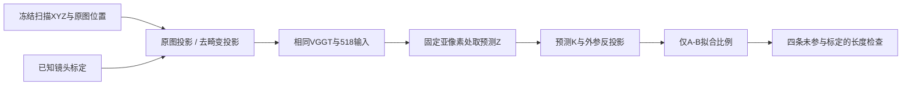
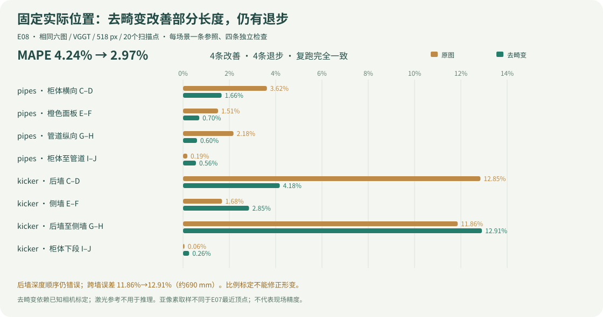
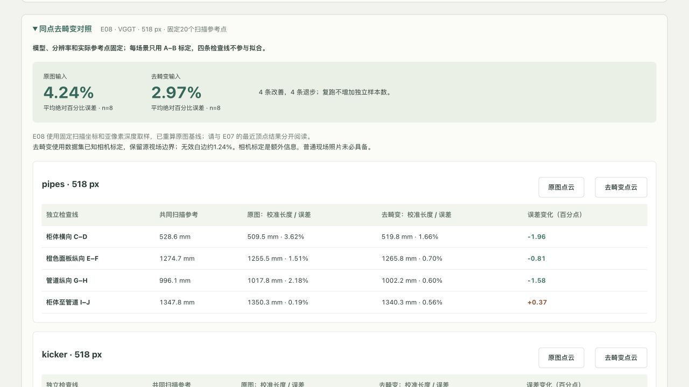
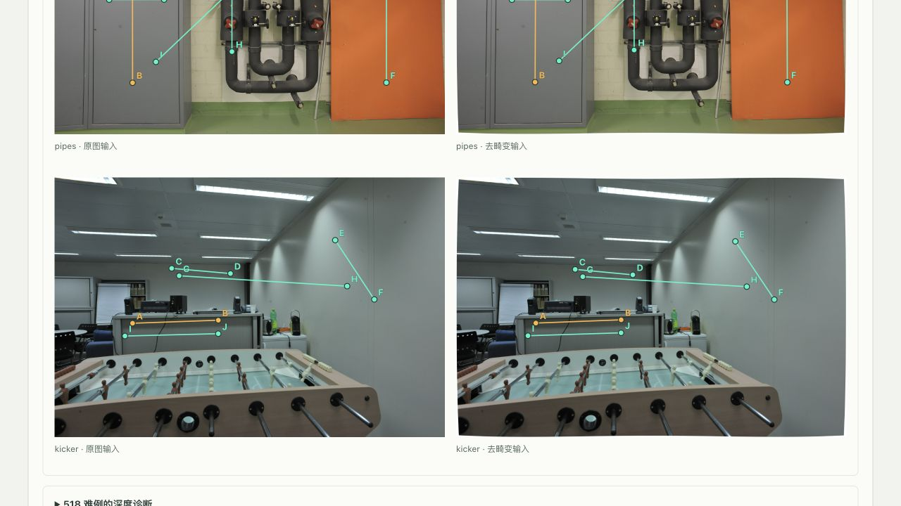
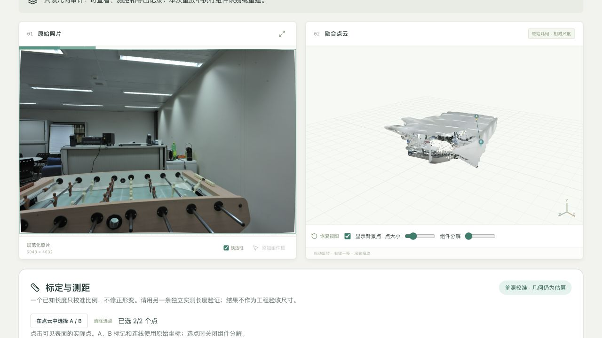

# E08：去畸变前后、固定实际位置的518对照

状态：8次真实VGGT推理与主轮/逆序复跑完成；结果部分改善且有退步。网页、审查与交付验证见文末追加记录。

用户要求同批照片、同模型、同分辨率、同实际取点位置，重点检查E07中518的kicker后墙C–D（12.59%，较336退步）及跨墙G–H（11.98%）。本轮固定518，不将E07最近输出像素的结果直接冒充严格同点基线。

## 已确定方法

- [执行计划](../superpowers/plans/2026-11-01-undistortion-fixed-points.md)。沿用原六张照片、三图顺序、VGGT权重和原始相机校准；不改产品默认336，不改DINO/SAM。
- **SCALE-008：严格同点对照不能依赖像素取整。** 固定E07/518保存的20个扫描参考XYZ及其原图像素，将同一物理点投到原图和去畸变图；在各自对应的亚像素位置取模型camera-Z，再用模型相机反投影。参考长度完全相同，四条检查线不参与比例拟合。
- 深度取样是连续预测表面的估计，新增审计顶点必须标为derived，保存四邻域/权重/相机/XYZ；不能称为模型直接输出的原始顶点。原始点图与经过有效支持筛选、但坐标未改变的模型样本GLB另存，现有API只接收审计GLB中的顶点索引，几何仍为相对尺度。
- 按COLMAP THIN_PRISM_FISHEYE相机计算full-field pinhole映射，使用[OpenCV remap](https://docs.opencv.org/4.13.0/da/d54/group__imgproc__transform.html)的目标→源映射；原图/去畸变图均保持原尺寸和相同模型输入尺寸。记录边界覆盖与白色无效区，不对结果做自适应裁剪。
- 去畸变使用数据集已知内参；GT深度/长度不用于图像变换或推理。相机内参是新增的预处理信息，实际用户照片不一定已有。白边及插值是这套处理的一部分，不能把变化只归因于一个抽象镜头参数。
- 检查E07评测辅助程序的应用启动副作用，确保新实验追加收据不会中断同一服务的其他任务；如复现则单独登记问题及RED/GREEN。
- 所有原图、变换图、数组、点云、数据库与日志继续在ignored目录；固定协议/结果摘要、测试、问题与结论入Git。新克隆用下载/预处理脚本复现。

以下为实际运行追加记录；初始设计、失败记录与E07历史结果保留。


## 受控执行与证据

基线 `8253f36`，协议与实现先提交为 `f148c36` 再推理。冻结协议 SHA256：`64a1d72b4f0f6f10125c2caca13b61649ed6202138f81243c370ffbc938c2ff2`；[完整协议](../measurement/undistortion-selection.json)、[主轮数值](../measurement/undistortion-results.json)、[逆序复跑](../measurement/undistortion-repeat.json)。主轮2026-11-01-e08-primary按original→rectified，复跑2026-11-01-e08-repeat反序。2场景×2条件×2轮，共8次真实调用；每个条件只有8条独立长度，重复运行不增加样本数。

模型为 `facebook/VGGT-1B`，权重revision `860abec7937da0a4c03c41d3c269c366e82abdf9`，代码revision `a288dd0f14786c93483e45524328726ab7b1b4ce`，checkpoint SHA256 `f164acf60724910d8fe1578bb499d800850c7bb0948db7555c413f9fbe60467e`（5,026,367,224 bytes），MPS，本机Apple Silicon；没有修改权重、训练或调用LLM。两条件均保留6048×4032照片、同一三图顺序和518×518模型张量；DINO/SAM未参与这次几何审计。产品默认336未改变，RTX5080/CUDA仍未实测。

原图分支先从原JPEG解码为无损PNG，其准备张量与E07原JPEG **哈希完全相同**；保存的原图模型数组也与E07逐项完全相同。E08的4.24%与E07的4.17%不同，原因是测量从最近模型顶点改为固定实际位置的亚像素取样，不能说成模型基线变差。每个场景两条件共用同一组5个参考长度，A–B独占标定，C–D/E–F/G–H/I–J均未参与比例拟合。



GT长度和深度没有进入模型或图像变换。相机标定是这次预处理额外拥有的信息，不是普通现场照片天然具备的条件。THIN_PRISM_FISHEYE投影遵循COLMAP角点坐标，转换到栅格中心时减0.5；模型反投影使用整数网格中心，不再加0.5。每边257点确定full-field新K、1025点独立检验，0.002边界余量；最小源边界余量约4.03 px。白色无效区pipes约1.243%、kicker约1.242%，没有按误差裁掉样例。OpenCV双线性remap、PIL bicubic及白边共同构成被测试的处理。

源有效区按bicubic缩小足迹保守腐蚀，再检查取样四邻域全部有效；所有20个端点均通过。前后物理点映射数学往返残差最大约9.1e-13原图像素，**这只验证坐标计算，不代表物理标注或尺寸精度**。

模型camera-Z在四个网格邻点间双线性插值，再用各条件预测K/外参反投影。`derived-anchor-audit.json`保存邻点索引、权重、Z跨度、K/外参及XYZ。审计GLB另加10点的 `measurement-anchors` 层；不可将其称为原始模型顶点。`raw-cloud.glb/.ply`是去掉无效支持区后的原始模型样本，坐标未修改，**不是完整未过滤点云**；`geometry.npz`保存模型数组。网页和API仍只提交GLB顶点索引，不接受浏览器自带XYZ。

## 主轮：全部独立检查

两条件总体MAPE **4.24398%→2.96569%**；4条改善、4条退步。最大误差 **12.84548%→12.90937%**，所以不能只凭平均值判断所有复杂结构均改善。下表每行共用同一真实参考，单位mm；Δ为去畸变减原图的误差百分点。

| 场景 / 检查 | 共同扫描参考 | 原图校准长度 | 原图误差 | 去畸变校准长度 | 去畸变误差 | Δ百分点 |
|---|---:|---:|---:|---:|---:|---:|
| pipes / Cabinet horizontal C-D | 528.6418 | 509.49 | 3.623% | 519.84 | 1.665% | -1.958 |
| pipes / Orange panel vertical E-F | 1274.7376 | 1255.47 | 1.512% | 1265.80 | 0.701% | -0.811 |
| pipes / Pipe vertical G-H | 996.1473 | 1017.85 | 2.178% | 1002.15 | 0.603% | -1.575 |
| pipes / Cabinet to pipe I-J | 1347.8165 | 1350.31 | 0.185% | 1340.30 | 0.558% | +0.373 |
| kicker / Back wall C-D | 1719.8135 | 1940.73 | 12.845% | 1791.65 | 4.177% | -8.668 |
| kicker / Side wall E-F | 772.8616 | 759.85 | 1.684% | 750.83 | 2.850% | +1.167 |
| kicker / Back wall to side wall G-H | 5347.8434 | 4713.39 | 11.864% | 4657.47 | 12.909% | +1.046 |
| kicker / Cabinet lower span I-J | 985.1184 | 984.52 | 0.061% | 987.70 | 0.262% | +0.201 |



## 518难例与退步分析

**kicker后墙C–D：长度改善不等于后墙形状正确。** 相对误差12.85%→4.18%，但C/D真实相机Z分别6279.5/6622.2mm，原图标定后5747.7/4725.5mm，去畸变后5628.6/4879.0mm。真实D比C远342.7mm，去畸变预测D仍比C近约749.6mm（原图约近1022.2mm）。深度顺序仍错误，长度误差的减小可能包含误差抵消，不能据此声称平面已恢复。

**kicker跨后墙至侧墙G–H：主要未解决的长距离。** 真值5347.84mm，原图4713.39mm，去畸变4657.47mm；误差11.86%→12.91%，偏差约690.37mm。G/H真实Z6327.1/1920.8mm，去畸变标定后5603.3/1833.1mm，远近跨度仍被压缩。它跨越更大深度范围，一条A–B比例不能修正非均匀形变。

其余退步：kicker侧墙1.68%→2.85%、柜体下段0.06%→0.26%；pipes柜体至管道0.19%→0.56%。后两项起始误差较小，绝对变化也小，仍保留。尚无独立物理端点不确定度估计，不能用任意误差阈值把退步删除。

**相机K辅助检验（不计入主对照）：** 保留同一rectified预测深度，只把反投影射线换为数据集已知pinhole K，另外仅用A–B重求辅助比例。kicker四条误差为4.37%、3.28%、12.65%、0.27%；pipes为0.31%、0.71%、0.61%、0.02%。跨墙仍约12.65%，因此单纯替换射线内参没有解决该难例。kicker预测fx/fy=279.87/281.22，已知为280.42/284.18（模型网格）；不能把它直接升级为“已证明深度头是唯一原因”。深度、相机、形状耦合与低纹理是后续待检验解释。

插值敏感性辅助：同一模型场上，“插Z再反投影”与“直接插3D点”的检查长度最大相差约0.1706mm。它仅是两种构造在这批输出上的差异，**不是实际端点误差、GT误差或现场精度的上界**。

**SCALE-010，新发现、尚未修复验证：** 现有prepare_images把短边舍入到14的倍数，6048×4032缩为518×350，而不是保持严格纵横比例；sy/sx=525/518=1.0135135，即垂直方向约1.35%的相对拉伸。两条件完全沿用相同流程，本轮没有变更。后续可在保持其他条件不变时对比保比例resize；目前不能把这项算作已证实根因或已生效改进。

## 复跑、耗时与重复性

主轮和逆序复跑四组的模型数组、原始样本云、审计GLB哈希及测量值完全一致，最大校准长度差0mm。它检验本机确定性，不提供额外独立场景或跨硬件一致性证明。

| 场景 / 条件 | 主轮worker墙钟(s) | 复跑worker墙钟(s) | 审计GLB完全相同 |
|---|---:|---:|---|
| pipes / original | 21.15 | 13.53 | True |
| pipes / rectified | 13.22 | 11.08 | True |
| kicker / original | 13.73 | 13.93 | True |
| kicker / rectified | 12.88 | 15.99 | True |

权重已缓存，每次调用为新worker进程，时间包含进程与模型载入，不包含首次下载、上传、浏览器或点云查看。三图去畸变warp本身pipes约4.22s、kicker约3.65s；不包含PNG保存等准备工作，不能与推理耗时混称端到端速度。主轮首个21.15s可能含系统初始化影响；样本太少，不能声称去畸变使模型更快。

## 问题、失败尝试和已实现改进

- **SCALE-008**：用最近模型像素会改变实际端点，故新增固定扫描位置、亚像素深度与派生端点证据链；几何及API RED/GREEN保存在ignored日志。原图张量和模型数组与E07相同，参考数组在条件间严格相同。
- **RUN-001**：原benchmark helper通过完整应用TestClient启动，会把同服务其他queued任务标为interrupted。先用独立queued任务复现失败，再改成仅注册正式measurement routes的轻量FastAPI，不启动executor/lifespan；测试确认已有queued状态不变。模型或其他服务未被重启来绕过问题。
- **SCALE-009**：去畸变部分有效，但跨墙退步、后墙深度顺序错误仍未解决；已保存全部结果与K辅助诊断，不能默认对所有现场照片启用。
- UI实现初次词典中两处带全角逗号/句号的中文对象键未加引号，TS解析失败；补引号后focused测试与build通过。`ui-initial-failed.log`、`build-initial-failed.log`保留，属于发布前实现错误，不是模型精度修复。
- 正式ML环境首次pytest误用了canonical checkout的editable包，报缺少本分支新增模块；显式设置本工作树PYTHONPATH后复测。`backend-ml-wrong-source-failed.log`保留，不把收集失败当作通过。
- 独立数学审查覆盖全部6张去畸变PNG像素、支持mask、输入张量哈希、20个GT位置/长度、已知K、80个端点与72个API收据、全部原始云样本；没有P1/P2。审查最初手算使用NumPy scalar promotion导致过严1e-12比较差1.61e-8 raw units，显式float64重算一致；属于审查数值精度问题，未改模型或结果。

## 网页与跨机器复现

生产网页“多角度点云 → 同点去畸变对照”展示原图/去畸变8条结果、同名实际端点照片叠加、深度诊断和两条件点云重放，中文/English/Español同步。分析与说明翻译，扫描点ID、型号/源备注与数值保留。照片叠加使用单独JPEG查看预览，模型输入仍为无损PNG。无本机归档照片时明确显示缺失提示；Git内汇总不要求原数据。新运行job ID不会等于冻结截图的旧ID，需要在恢复框输入新ID。

```bash
uv sync --frozen --extra dev
npm --prefix apps/web ci
make setup-multiview
make models-multiview
.venv/bin/python scripts/undistortion_benchmark.py --download --prepare
.venv/bin/python scripts/undistortion_benchmark.py --run --run-name my-e08-primary
.venv/bin/python scripts/undistortion_benchmark.py --run --conditions rectified original --run-name my-e08-repeat
npm --prefix apps/web run build
PV3D_DATA_DIR="$PWD/data/measurement-public/runtime" make serve
```

`--prepare`重新生成并验证已冻结协议，不需要重新freeze；新run名不得覆盖已有结果。原始E07官方下载约1.06GB、解压约6GB，另有E08无损输入/模型产物和约5GB权重。下载源、原图/相机/扫描参考SHA沿用E07协议。`scripts/publish_undistortion.py`发布本次固定归档run名的摘要；一般新实验保留其独立summary，不自动替换本次历史网页。

本机证据根目录 `data/measurement-undistortion/`：`preparation.json`、`inputs/`、`runs/2026-11-01-e08-primary/`、`runs/2026-11-01-e08-repeat/`及全部失败/通过日志。每case保存input、geometry.npz/json、worker日志、derived-anchor-audit、diagnostics及receipt。重放DB追加在 `data/measurement-public/runtime/`，没有复制或覆盖旧E07任务。两目录均ignored；新克隆没有照片/权重/数据库。ETH3D照片与衍生截图按CC BY-NC-SA4.0，VGGT按CC-BY-NC4.0；见[来源记录](../assets/README.md)。

## 接手顺序与未验证范围

优先针对kicker跨墙，冻结本轮作为基线，单独测试保比例resize，继续固定相同物理点与A–B比例；再考虑已知相机约束下的几何优化或更多视角。不要同时换模型、视角和resize后只看均值。可加入不确定度、平面/深度顺序检查，但不能用过滤来删除坏结果。

当前仅两公开场景；扫描配准和物理端点的不确定度没有独立标定。没有现场PV设备实测长度，没有桌球台可用GT，也没有完成毫米级工程精度、5080或泛化验证。


## 实现与运行验证（交付前）

- 全后端开发环境：130 passed，2个可选ML测试skip；正式ML环境用本分支PYTHONPATH：132 passed。前端18文件/70 tests passed；tsc/Vite生产build、Ruff通过。10张中英SVG均由冻结JSON/作者图确定性生成并通过`--check`。日志保存于ignored实验目录的`*-final.log`。
- UI focused RED→GREEN覆盖冻结前后数值、不同参考数组时拒绝汇总、两条件同名端点、英/西语言保持数值和标记、缺本机照片提示、去畸变job恢复回调。几何9条与API回放2条测试覆盖坐标、支持区、原始/派生区分及无关任务不被中断。
- 原生浏览器连接最初失效，重建会话后恢复；不是重启服务/模型。其后实际生产8004网页载入全部4张6048宽预览，点位叠加与8条误差一致；真实截图不经修图。

网页手工验证：生产8004载入原图与去畸变kicker两任务，均显示1个参照、8条相对/校准收据；原图G–H端点为measurement-anchors #6/#7、4713.39mm，与冻结结果一致。对照表4.24%/2.97%、12.91%，深度诊断C/D/G/H及known-K12.65%在中/英/西切换保持数值；4张照片6048宽全部实际载入，A–J叠加对应同一扫描位置。缺照片回退由前端测试覆盖。





截图为1280×720原生JPEG；来源/许可见素材记录。校验和：

- `undistortion.zh.jpg`：`0ffe00b2c9a27e4cbc141f28e80deff3533808306856cff4adc6adef7b68f5f1`
- `undistortion.en.jpg`：`452513fabd568f6ea6ac85351202363594bc4179005ed1e029ca3bfc2c790a39`
- `undistortion-points.zh.jpg`：`ee7fa16a1b1080bdf5ee7f883e847d6bec25a3884a6a83004e8a6184174f408a`


## 最后独立审查及修复（2026-11-01）

独立整分支审查`8253f36..7a4038a`没有P1/P2，复测11后端/2前端通过；提出一项非阻塞P3：benchmark把case失败写入summary后仍退出0，自动化可能误当成功。登记 **RUN-002**，用两个无模型的故障worker先验证`DID NOT RAISE SystemExit`，修复为所有case与摘要保存完后，有任何失败则非零退出；GREEN确认两条失败都保留。日志`runner-exit-red.log`/`runner-exit-green.log`。不改模型、冻结协议、原始输入或归档8次结果。修复后全开发后端 **131 passed/2 ML skip**、正式ML后端 **133 passed**、Ruff通过。

去畸变kicker重放G–H也已实测：measurement-anchors #6/#7，4657.47mm，独立误差690.37mm/12.91%，与主轮完全一致；可见明确派生端点提示与“参照校准·几何仍为估算”。通用查看器将这条检查线显示为A/B，它不是参照标定的A–B。



截图SHA256：`73d172e44de446500060f925e97f4a2f601af40e7597ed1c153376bf22df0e58`。照片为ETH3D kicker/DSC_6503的去畸变预览和实际VGGT可见表面，不作为后墙形状正确的证据。
