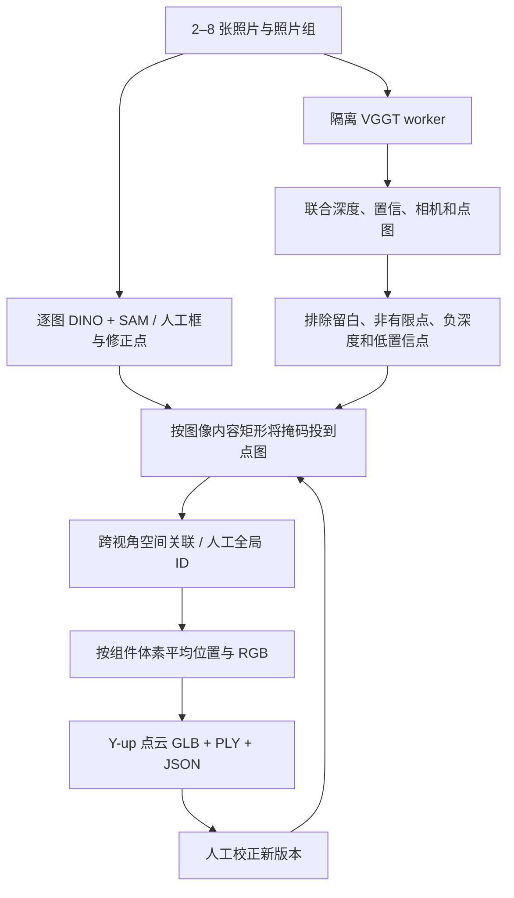

# V3 几何模型、融合与限制

## 当前固定版本

| 项目 | 配置 |
| --- | --- |
| 几何源码 | `facebookresearch/vggt` commit `a288dd0f14786c93483e45524328726ab7b1b4ce` |
| 几何权重 | `facebook/VGGT-1B` revision `860abec7937da0a4c03c41d3c269c366e82abdf9`，`model.safetensors`，5,026,367,224 bytes |
| 图像输入 | 默认 336×336；完整照片按比例缩放、14 像素对齐、居中留白，不裁掉上下部件；每张保存内容矩形用于标注映射 |
| 几何分支 | 联合相机＋深度及其置信图，再反投影到共同世界坐标；关闭未使用的 point／track heads |
| 逐图语义 | 与 V2 相同的真实 Grounding DINO tiny＋SAM 2.1 tiny，每图采用 multiple 候选保留；仍使用逆变器类别词表 |
| 运行环境 | API 的 NumPy 2 与 `services/multiview/.venv` 的 NumPy 1.26 隔离；PyTorch 2.8；分别固定依赖锁 |

官方推荐用深度和相机反投影，源码／坐标约定见 [固定版官方 README](https://github.com/facebookresearch/vggt/blob/a288dd0f14786c93483e45524328726ab7b1b4ce/README.md#detailed-usage)。本项目没有将互不相关的单图相对深度直接叠加，也没有运行 COLMAP bundle adjustment。

**许可分开看：**所用源码按该 commit 的 [VGGT License](https://github.com/facebookresearch/vggt/blob/a288dd0f14786c93483e45524328726ab7b1b4ce/LICENSE.txt)；原始权重的模型卡标记 `cc-by-nc-4.0`。官方明确区分原始非商业权重和需申请的 `VGGT-1B-Commercial`，见同版 README 的 [许可更新](https://github.com/facebookresearch/vggt/blob/a288dd0f14786c93483e45524328726ab7b1b4ce/README.md#updates)。当前仅接入原始公开研究权重，未申请／下载商业 checkpoint，也未接受额外账号协议；代码仓库私有不意味着模型可商用。结果 `model.license` 记录的是 checkpoint 标签，不能替代完整条款。

## 服务端数据流

置信过滤使用每个视角的有效内容点第 35 百分位阈值，分数不是校准概率。自动跨视角关联仅比较同类、不同视角的点支持；保守要求双向邻近支持，且集合合并不得造成同一视角的两个观察被合为一个组件。细掩码优先，明确人工区域优先于自动区域。自动关联是候选，允许手动拆开或关联。

体素大小按场景相对范围确定，同一个体素内**不同组件不互相平均**。最终最多 150,000 点，按组件确定性采样以保留小组件；颜色取照片 RGB。OpenCV 世界坐标统一变换一次 `[x,-y,-z]` 为 Y-up。未知／未归属点单独作为 `__context__`。

模型数组和相机保存在原始几何任务目录。人工任务只能引用同一 capture 的已完成 base，复用其 `geometry_job_id`；校正的 mask 引用必须与照片、外接框匹配，自动SAM与人工细化均保存完整二值 PNG，以保留孔洞与不连通区域；简化轮廓仅用于显示。客户端不能提交任意 mask 或宿主机路径。

几何支持诊断用重投影深度一致性与相机基线／深度比；它们是初步诊断，不证明度量精度或设备身份。没有有效点时不给出假 GLB；没有语义或组件零点时保留 `needs_review`，非空背景仍可查看。

## 设置与实测

`PV3D_MULTIVIEW_DEVICE=auto|cuda|mps|cpu`，默认继承 `PV3D_DEVICE`；自动选择 CUDA → MPS → CPU。多图 worker 出错会明确失败，不静默伪造／切换几何。`PV3D_VGGT_SIZE=224|336|518` 为启动时设置；只有 336、三图在本机 M4 Pro／24GB／MPS 实测。8 图、518、CPU 和 RTX 5080 的峰值内存与耗时待测；内存不足先用 2–3 张／224 重试并核对质量。

`PV3D_MULTIVIEW_PYTHON` 可指定匹配的隔离 Python，默认 `services/multiview/.venv/bin/python`。权重默认共用 `PV3D_MODEL_DIR`。worker 具有 30 分钟硬时限，错误细节在本地 `data/runtime/multiview/<job>/worker.log`，对外只返回可重试的摘要。该时限不是日常预期耗时。

以下为审查及并行检测修复合入前的链路测量。2026-10-31 实测公开 VGGT kitchen 00／01／02（同一玩具、不同角度）：真实网页约 26.7 秒载入 102,219 点；其中服务端约 26.1 秒，进程模型加载约 12.9 秒、几何计算约 2.0 秒、逐图识别约 9.5 秒。JPEG 规范化与直接 PNG 测试数值不同，不能当成模型重复性基准。一次人工 SAM 修正后约 0.8 秒显示新点云，服务端约 0.15 秒，`geometry_ms=0`。研究样图被光伏词表误检，未作为设备类别验证。详见 [验证记录](../verification.md)。

## 接下来如何改善

先收集真实逆变器多视角组，按物理设备留出测试数据，分别测框／掩码、细线保留、跨视角关联错误、几何一致性和端到端时延。之后比较更高分辨率／分块、SAM 2 大模型与更合适的几何模型（包括 VGGT-Omega 等），在 RTX 5080 上实际记录显存。SAM 变大主要改善掩码，不自动恢复遮挡、深度或电气拓扑。

真实尺度、精确网格／CAD、箱变／变压器词表及结构配置是后续独立功能；不能用本轮 toy-scene 跑通代替验收。
